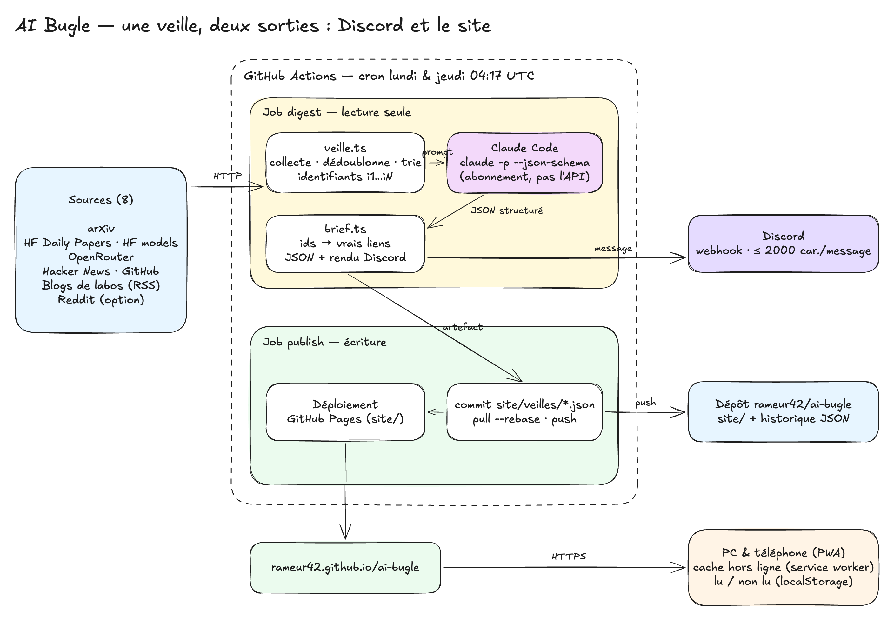

# AI Bugle — documentation technique

Mise à jour : 22 octobre 2026. Exportée de la [doc Claude](https://claude.ai/artifact/AQbQ2ySDnoH1vB2eQ8a5b2), qui reste la version de référence.

## Vue d'ensemble

AI Bugle est une veille IA/tech en français, produite automatiquement le lundi et le jeudi tôt le matin (cron à 04:17 UTC) et lue à trois endroits : un salon Discord, un site web et une application installée sur le téléphone. Une seule personne la lit ; il n'y a ni compte, ni serveur, ni base de données.

À chaque exécution, un script collecte quelques milliers d'items (papiers, sorties de modèles, discussions), Claude en tire un brief structuré, et ce brief est à la fois posté sur Discord et ajouté à l'historique du site.

| Où | Adresse | Ce qu'on y trouve |
| --- | --- | --- |
| Site | [rameur42.github.io/ai-bugle](https://rameur42.github.io/ai-bugle/) | Toutes les veilles, recherche Google par news et par notion |
| Application | même adresse, « Ajouter à l'écran d'accueil » | Le site en plein écran, lisible hors ligne |
| Discord | salon du webhook | La veille du jour, avec un lien vers sa page sur le site |
| Code | [github.com/rameur42/ai-bugle](https://github.com/rameur42/ai-bugle) | Scripts, site, workflow, historique des veilles en JSON |

Les sources : arXiv (toute la fenêtre d'annonce), Hugging Face Daily Papers et modèles tendance, OpenRouter, Hacker News, GitHub, huit blogs de labos et médias, Reddit en option.

## Architecture

Une seule exécution GitHub Actions produit la veille et l'envoie vers deux sorties : Discord tout de suite, puis le dépôt et le site. Il n'y a aucun serveur à maintenir : le calcul tourne dans GitHub Actions, le site est statique sur GitHub Pages, et l'état de lecture vit dans le navigateur.

Le job **digest** lit des données venues de l'extérieur, donc il n'a qu'un jeton en lecture ; seul le job **publish**, qui n'exécute que des étapes de confiance, peut écrire dans le dépôt et déployer Pages. La veille passe de l'un à l'autre sous forme d'artefact.

| Fichier | Rôle |
| --- | --- |
| `scripts/daily/veille.ts` | Collecte, dédoublonnage, tri, appel à Claude, écriture du JSON, envoi Discord |
| `scripts/daily/brief.ts` | Format de la veille, schéma imposé à Claude, résolution des liens, index, rendu Discord |
| `scripts/daily/discord.ts` | Découpage en messages de 2 000 caractères et envoi au webhook, avec reprise sur 429 |
| `.github/workflows/ai-bugle.yml` | Cron, jobs digest et publish, option « site seul » |
| `site/` | Le site et l'application ; `site/veilles/` contient l'historique |

Le schéma est un fichier Excalidraw modifiable : `docs/architecture.excalidraw` dans le dépôt, à ouvrir sur [excalidraw.com](https://excalidraw.com) (menu Ouvrir).

## Le brief structuré

Chaque veille est un fichier JSON, `site/veilles/AAAA-MM-JJ.json`, et c'est l'unique source du site comme de Discord. Claude ne rédige plus du Markdown libre : `claude -p --json-schema` lui impose un schéma, et la réponse validée arrive dans le champ `structured_output`.

**Claude ne fournit jamais d'URL.** Chaque item brut envoyé dans le prompt porte un identifiant court (`i12`) ; Claude cite ces identifiants, et `resolveBrief()` les remplace par les vrais liens. Un identifiant inconnu est ignoré : un lien peut manquer, jamais être inventé. Pour Hacker News, le lien de l'article porte le nom de son site et un second lien ouvre le fil de discussion.

| Champ | Contenu |
| --- | --- |
| `date`, `generatedAt` | Jour de la veille (UTC) et heure de génération |
| `lookbackHours`, `itemCount`, `model` | Fenêtre couverte, nombre d'items collectés, modèle Claude |
| `brief.essentiel` | 5 à 8 news : ce qui compte vraiment |
| `brief.papiers` | 3 à 6 papiers, sur le résultat concret |
| `brief.sorties` | Sorties majeures seulement ; liste vide = « Rien de majeur sur la période » |
| `approfondir` | Liens bruts classés (papiers, discussions), sans passer par Claude |

Une news = `cat` (catégorie en 1 ou 2 mots : Sécurité, Modèles, Infra…), `title`, `lead` (l'accroche, une phrase), `text` (la suite, 1 à 2 phrases), `sources` (titre, URL, nom de la source) et `notions` (2 à 4 termes à chercher). Les veilles d'avant le 22 octobre 2026 n'ont ni `cat` ni `lead` : le site prend alors la première phrase de `text` comme accroche. Si Claude échoue, `brief` vaut `null` : la veille est quand même écrite avec ses liens.

`site/veilles/index.json` est reconstruit à chaque exécution à partir de tous les fichiers du dossier : date, titre de la première news, nombre de news par section. Une veille relancée le même jour remplace celle du jour.

Le message Discord est rendu depuis ce JSON par `renderMarkdown()` : en-tête « AI Bugle — date », une ligne par news (accroche puis suite) avec ses liens, sans les notions, découpé en messages de 2 000 caractères au plus, aperçus de liens désactivés.

## Le site et l'application

Le site est du HTML, CSS et JavaScript sans framework ni étape de build : le dossier `site/` est publié tel quel sur GitHub Pages et se sert aussi en local avec `python3 -m http.server -d site 8000`. Au chargement, il lit `veilles/index.json`, puis le JSON de la veille ouverte.

| Fichier | Rôle |
| --- | --- |
| `index.html` | Coquille unique : en-tête (logo, menu, bouton de thème), zone d'affichage, pied de page, bouton de sélection |
| `app.js` | Routeur, rendu des pages, recherche Google, sélection, partage, thème, lu / non lu |
| `style.css` | Design « Le fil » : Schibsted Grotesk, Source Serif 4 et JetBrains Mono, accent orange, thème clair et sombre, menu en bas sur téléphone |
| `sw.js` | Service worker : réseau d'abord, cache en secours hors ligne |
| `manifest.webmanifest` + `icons/` | Installation comme application (`display: standalone`) |

**Trois routes.** `#/` affiche directement la dernière veille. `#/AAAA-MM-JJ` affiche une veille précise : c'est le lien posté sur Discord. `#/archives` liste toutes les veilles, la plus récente en haut, avec un badge « Nouveau » ; le logo AI Bugle y mène.

**Une page de veille.** En tête : jour de la semaine, date, nombre d'items, de sujets et temps de lecture estimé. Sur ordinateur, un sommaire « Dans cette édition » reste à gauche. Les news de L'essentiel sont numérotées, avec leur catégorie et leur accroche ; « Lire plus » ouvre la suite, les sources, la recherche Google et les notions, et « Partager » ouvre le partage du téléphone ou copie le lien. Les sorties sont des cartes inversées, et Pour approfondir aligne le score (▲ votes ou points Hacker News) à gauche de chaque lien. Le menu met en gras la section en cours ; sur téléphone, il devient une barre fixée en bas de l'écran.

**Recherche Google, trois entrées.**

- Le bouton « Google » d'une news cherche le titre original de sa première source, plus précis que le titre reformulé.
- Chaque notion est une pastille qui lance la recherche de ce terme.
- Toute sélection de texte fait apparaître un bouton flottant « Rechercher sur Google » sous la sélection. Sur écran tactile il se place 30 px plus bas pour éviter les poignées de sélection, et reste affiché 600 ms après la fin de la sélection, le temps d'un tap.

**Lu / non lu** est gardé dans le stockage local du navigateur (clé `veille-ia:read`), donc propre à chaque appareil, comme le choix du thème (clé `ai-bugle:theme` ; sans choix, le site suit le réglage du système). **Hors ligne**, le service worker sert la dernière version mise en cache : toute veille ouverte une fois reste lisible. Le contenu est inséré comme texte, jamais comme HTML, et seuls les liens `http(s)` sont affichés.

## Configuration et exploitation

Tout se règle dans GitHub, Settings → Secrets and variables → Actions ; aucune clé n'est dans le dépôt. Le brief passe par l'abonnement Claude, pas par l'API : il ne faut jamais ajouter `ANTHROPIC_API_KEY`, que le script retire de toute façon.

| Nom | Type | Rôle |
| --- | --- | --- |
| `CLAUDE_CODE_OAUTH_TOKEN` | secret | Active le brief ; créé avec `claude setup-token` |
| `VEILLE_DISCORD_WEBHOOK_URL` | secret | Webhook du salon Discord |
| `REDDIT_CLIENT_ID` / `REDDIT_CLIENT_SECRET` | secrets, optionnels | Reddit bloque les IP de CI sans OAuth |
| `VEILLE_MODEL` | variable, optionnelle | Modèle Claude, par défaut `claude-sonnet-5-5` |
| `VEILLE_REQUIRE_DISCORD` | variable, optionnelle | Par défaut `true` : l'exécution échoue sans webhook |

**Opérations courantes.**

| Besoin | Comment |
| --- | --- |
| Lancer une veille hors calendrier | Actions → « AI Bugle — Monday & Thursday » → Run workflow, depuis `main` |
| Republier le site seul (après une modification du site) | Même bouton, case « Redeploy the site only » cochée : ni Claude ni Discord |
| Tester en local | `node scripts/daily/veille.ts` avec `claude` connecté ; sans webhook, le digest s'affiche dans le terminal |
| Voir le site en local | `python3 -m http.server -d site 8000` |
| Tests | `node --test scripts/daily/brief.test.ts` (9 tests) |

**Limites connues.**

- L'API arXiv refuse souvent les grosses requêtes (HTTP 429) ou les laisse expirer, y compris celles des machines GitHub : les veilles du 18 au 22 octobre 2026 sont sorties sans papiers arXiv bruts. Depuis le 22 octobre, le collecteur demande des pages de 500 résultats, réessaie jusqu'à 4 fois avec des pauses de 15 s, 45 s puis 135 s, et, si l'API ne répond toujours pas, se rabat sur le flux RSS d'arXiv, qui ne contient que le dernier jour d'annonce.
- Le cron GitHub est « au mieux » : la veille du 22 octobre 2026 est partie avec 5 h 40 de retard. Le cron part donc à 04:17 UTC pour garder de la marge dans la matinée. Il se désactive après 60 jours sans commit, mais chaque veille commitée compte. Renommer le fichier du workflow peut le désinscrire du planificateur : c'est arrivé le lundi 19 octobre, réparé en désactivant puis réactivant le workflow.
- L'environnement `github-pages` n'accepte que `main` : un lancement depuis une autre branche échoue à la publication.
- Le bouton de sélection a été vérifié en émulation mobile et sur téléphone en local, pas encore en HTTPS sur un appareil réel.
- Hors ligne, les polices viennent de Google Fonts et ne sont pas en cache : le site s'affiche alors avec les polices du système.
